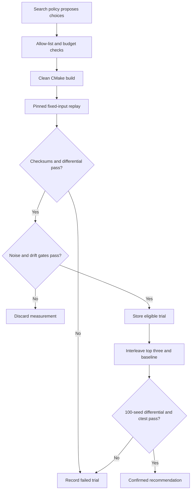

# CompilerPilot

**Compiler search with a correctness oracle.** CompilerPilot tunes how [Ledger](https://github.com/michaelbawuah/Ledger) is compiled, measures throughput and tail latency, and rejects builds that change matching behavior. Ledger is pinned as a submodule; its engine code is unchanged.

The same Python harness runs random, genetic, surrogate-guided and LLM-guided search. The model proposes typed compiler choices. Python owns compilation, measurement, the build budget and recommendation eligibility.

## Current evidence

This release implements the research workflow and contains real compiler/correctness qualification artifacts under `results/`. The results report distinguishes functional qualification from a completed performance experiment. **No speedup is claimed until the noise, correctness and interleaved-confirmation gates pass.** Live provider experiments require an API credential and a pinned model. Missing credentials cause an explicit error.

See [measured results](results/summary.md), [methodology](docs/methodology.md), and [qualification status](results/status.md).

## Run it

Linux x86-64, Python 3.11+, GCC 13+, Clang/LLVM 17+, CMake 3.21+, Ninja, binutils and `taskset` are required. Install matching LLVM profiling and `lld` packages for Clang PGO/ThinLTO. Hardware `perf` events need host support and permissions; unavailable counters are recorded explicitly.

```bash
git clone --recurse-submodules https://github.com/michaelbawuah/compilerpilot.git
cd compilerpilot
python3 -m venv .venv
. .venv/bin/activate
python -m pip install -e '.[dev]'
python -m pytest
python -m compilerpilot data
python -m compilerpilot baseline --cpu 0 --run-id E1
python scripts/check_gate.py --input data/eval.lob
```

Choose a CPU allowed by `taskset -pc $$`. Keep the machine quiet during measurement. Each baseline command makes ten observations, each with five benchmark runs and a warmup. A failed noise gate stops subsequent search.

```bash
python -m compilerpilot sweep --cpu 0 --run-id E2
python -m compilerpilot experiment --strategy random --budget 40 --seed 0 --cpu 0
python -m compilerpilot experiment --strategy genetic --budget 40 --seed 0 --cpu 0
python -m compilerpilot experiment --strategy surrogate --budget 40 --seed 0 --cpu 0
# Set OPENAI_API_KEY or ANTHROPIC_API_KEY securely in your environment first.
python -m compilerpilot experiment --strategy agent --provider openai --model MODEL_ID --budget 40 --seed 0 --cpu 0
python -m compilerpilot report
```

Use an exact model version that supports tool use, temperature zero and, for OpenAI, the seed parameter. The tool loop records model, sampling settings, request/response traces, hypotheses and tool results. Anthropic does not expose a matching seed parameter; that limitation is recorded. A provider error is an incomplete experiment, never a fallback search result.

`python scripts/run_study.py --model MODEL_ID --provider openai --cpu 0` runs E1, E2 and the full E3 matrix sequentially: four strategies, three seeds and forty unique builds per strategy/seed. Preflight credentials first. Run IDs cannot overwrite existing evidence. A noisy or drifting batch stops the study and must be rerun under a new ID. Reports inventory all attempts.

## How a trial works



Every successful benchmark checks the reference, fast-bitmap and fast-linear event/trade checksums and final state, verifies raw CSV medians against JSON, and runs an independent five-seed × 100,000-command differential test. The binary's recorded flags, input SHA-256, binary SHA-256, CPU affinity and pinned source identity must match the trial.

Each candidate uses a clean directory and bounded subprocess execution without a shell. Compile failures consume budget. Duplicate candidates do not. Successful builds must be measured before a run can finish. Builds that fail correctness can never be recommended. Source changes and evaluation-input changes invalidate comparison.

## Search space

| Choice | Allowed values |
|---|---|
| Compiler | GCC, Clang |
| Optimization | O2, O3 |
| ISA | portable default, x86-64-v3, native |
| LTO | off, full GCC LTO / Clang ThinLTO with lld |
| PGO | off, separate-seed instrument/train/use pipeline |
| Inline threshold | default, 100, 500 |
| Loop unrolling | default, enabled |
| Vectorization | default, disabled |
| Frame pointer | default, preserved |
| Function alignment | default, 32, 64 bytes |
| Semantic interposition | default, disabled |

Unsafe math, free-form flags, arbitrary executables and source rewrites are excluded. `space.py` maps typed values to fixed flags. GCC and Clang PGO use distinct compiler-specific pipelines, with training seed 20261012 and evaluation seed 20261011 by default. Training profiles must exist, and the measured hot-path profiles must be consumed. LLVM pass reordering is an unimplemented stretch goal.

Random search samples the allow-list. Genetic search uses population eight, tournament selection, one-point crossover and 0.2 mutation rate. Surrogate search starts with eight measured trials, then ranks an unseen candidate pool with a random forest. Training uses one-hot compiler choices and log measured speedup, excluding failed or invalid measurements. Predictor validation deduplicates repeated candidates before out-of-fold evaluation; it reports MAE in speedup percentage points and Spearman correlation.

## Evidence and confirmation

`results/trials.parquet` indexes every candidate, including failures. Each run retains an append-only `trace.jsonl` and `trials.jsonl`; atomic snapshots reflect later drift invalidations. All strategies share the same harness. Reports keep independent runs separate and label incomplete protocol coverage. They never merge favorable observations across repeated attempts.

To confirm three measured builds:

```bash
python -m compilerpilot confirm \
  --baseline results/runs/RUN_ID/baseline.json \
  --candidates builds/RUN_ID/CANDIDATE_A/build.json builds/RUN_ID/CANDIDATE_B/build.json builds/RUN_ID/CANDIDATE_C/build.json \
  --input data/eval.lob --rounds 10 --cpu 0
```

Confirmation uses A, B, C, baseline in each round. A speedup must exceed three baseline standard deviations. Baseline CV and drift must remain below 2%; candidate noise is also checked. Final recommendation requires a 100-seed × 1,000,000-command differential test and the complete Ledger CTest suite. `finish` is explicitly provisional until confirmation.

## Limitations

One synthetic workload on one CPU cannot establish general compiler performance. PGO may overfit its training distribution even with separate seeds. Shared hosts can fail the noise gate; CPU pinning does not eliminate contention or frequency changes. Hardware counters can be unavailable in virtual machines. Models and provider behavior vary across versions, and temperature zero does not guarantee identical decisions. A negative or incomplete comparison remains visible in the report.

This project does not publish resume speedup or predictor-accuracy numbers before the corresponding experiments produce them.
